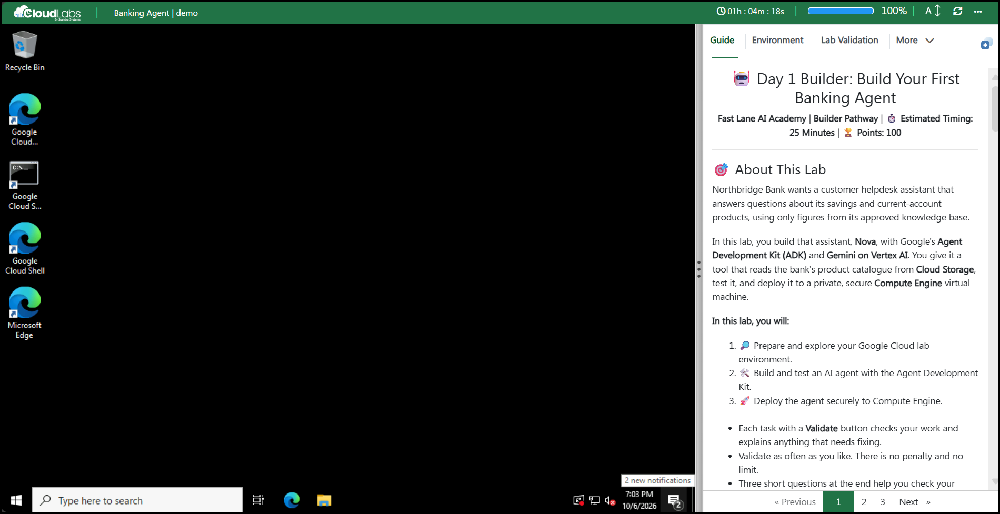
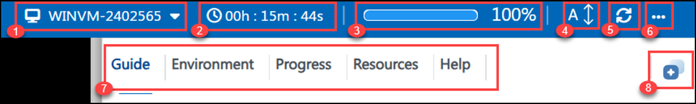
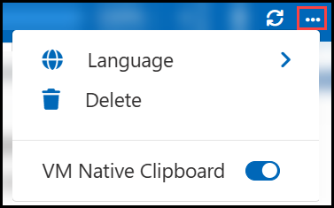
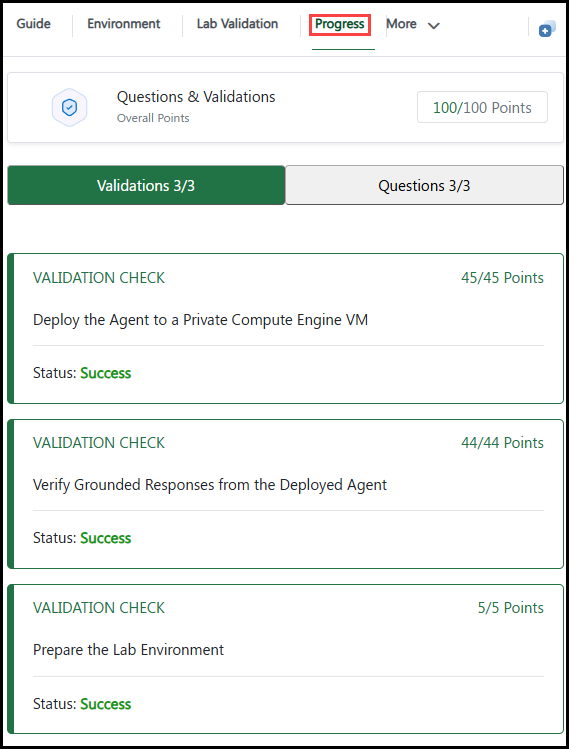
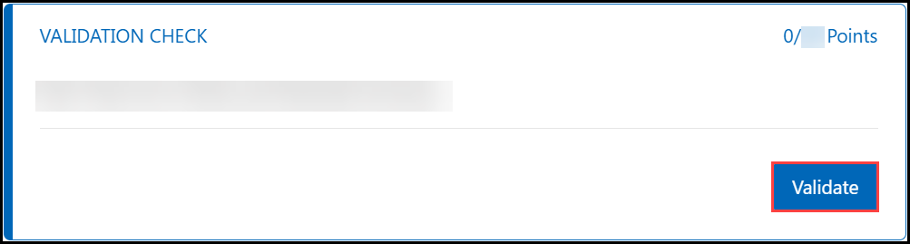

<h1 align="center">🧦 Day 2: Stocking Fillers 🎁</h1>

<b>❄️ 12 Days of AI Agents: The Christmas Change Freeze ❄️</b> | <b>🛷 Track A: Developer</b> | 🏆 <b>Challenge</b> | ⏱️ <b>Estimated Timing: 60 Minutes</b> | 🎯 <b>Points: 100 (+10 Christmas Bonus)</b> | 🎖️ <b>Badge: Toolsmith</b>

🔔 ✨ 🦌 🎄 🦌 ✨ 🔔

---

## 🎄 About This Lab

It's the busiest fortnight of the year at **Hollyfield Building Society** 🏦. Festive spending is up, savings-club payouts are due, and the Christmas change freeze starts on **Christmas Eve**.

Yesterday you woke up **Holly**, Hollyfield's new customer agent. Today customers want their **real** balance, not a general answer. Your mission: give Holly her first **function tools**, so she can look up live balances and savings rates in Hollyfield's **core-banking API** on **Cloud Run**, and handle the moment a customer types the wrong account number.

**🧭 How this lab works**

- 🎯 This is the **Challenge** version: each challenge gives you a **goal**, the **rules** your solution must follow and a few **hints**. There are no copy-and-paste steps. (The **Guided** version of Day 2 has step-by-step instructions, but earns fewer points.)
- ✅ The validators check your **result**, not the commands you used. Validate as often as you like; there is no penalty and no limit.
- 🎄 The **Christmas Bonus** at the end is optional and earns extra points.
- 🧠 A short Knowledge Check closes the lab.

---

## 🗺️ The Road to the Change Freeze

| Day | Lab | Status |
|:---:|---|:---:|
| 1 | 🔔 **Holly Wakes Up** | ✅ Done |
| 2 | 🧦 **Stocking Fillers** | 📍 **Today** |
| 3 | 🌙 **Silent Night, Grounded Answers** | 🔜 |
| 4 | 🧠 **Holly Remembers** | 🔜 |
| 5 | 🎁 **Ask Before You Wrap** | 🔜 |
| 6 | 🌿 **The Holly and the Ivy** | 🔜 |
| 7 | 🥧 **The Mince Pie Mob** | 🔜 |
| 8 | 😇 **Naughty or Nice?** | 🔜 |
| 9 | ☁️ **Deck the Cloud** | 🔜 |
| 10 | 🚪 **Who Goes There?** | 🔜 |
| 11 | ✨ **All Is Calm, All Is Bright** | 🔜 |
| 12 | 🎅 **Christmas Eve Go-Live** | 🏁 Capstone |

---

## 🖥️ Lab Environment

The lab window is split into two parts:

- **Left side:** your lab virtual machine (VM), a Windows workstation with a browser.
- **Right side:** the lab guide, with the challenges to complete.

Your environment is an **isolated Google Cloud project** created only for you. All data in it is **synthetic**: no real customers, accounts or rates. It has been pre-provisioned with:

| Resource | Value |
|---|---|
| ☁️ **Project ID** | <inject key="ProjectId" enableCopy="true"/> |
| 🌍 **Region** | <inject key="Region" enableCopy="true"/> |
| 🧰 **Hollyfield workbench bucket** | <inject key="WorkbenchBucket" enableCopy="true"/> |
| 🏦 **Core-banking API (Cloud Run service)** | <inject key="CoreBankingService" enableCopy="true"/> |

---

## 🧭 Lab Window Controls

| # | Control | Use |
|:---:|---|---|
| 1 | **VM name** | Shows the lab VM you are connected to. |
| 2 | **Timer** | Time remaining in your lab session. |
| 3 | **Progress bar** | Your progress through the lab. |
| 4 | **A↕** | Change the text size of the lab guide. |
| 5 | **Refresh** | Reconnect the VM if the screen stops responding. |
| 6 | **More (...)** | Language, Delete and VM Native Clipboard options. |
| 7 | **Lab guide menu** | Guide, Environment, Progress, Resources and Help. |
| 8 | **Split window** | Split the lab guide and the VM into separate windows. |

### 6️⃣ More Options

| Option | Use |
|---|---|
| 🌍 **Language** | Switch the lab language, if multi-language support is enabled. |
| 🗑️ **Delete** | Delete the environment once your lab is complete. |
| 📋 **VM Native Clipboard** | Allows copying files within the VM. While it is on, text copied from your local PC cannot be pasted into the VM using keyboard shortcuts. You can turn it off at any time from **More (...)**. |

### 7️⃣ Lab Guide Menu

| Option | Use |
|---|---|
| 📖 **Guide** | All tasks and lab information. |
| 🔑 **Environment** | All required credentials and lab details. |
| 📈 **Progress** | Your points for validations and questions. |
| ⚙️ **Resources** | Start and stop the lab VM. |
| ❓ **Help** | Support information. |

### 📈 Progress

The **Progress** tab shows your overall points, with separate views for **Validations** and **Questions**.

### 📄 Page Navigation

Use **Previous**, the page numbers and **Next** at the bottom of the guide to move between pages.

---

## ✅ Validate Your Work

1. Complete the challenge.
1. Scroll to the **Validation Check** under it.
1. Click **Validate**.

- 🎉 On success, the status shows **Success** and the points are added to your **Progress**.
- 🔧 If a check fails, read the message, fix the issue and click **Validate** again.

> 💡 **Tip:** The first task, **Prepare Hollyfield**, is also a **Validate** button. Click it before anything else. It builds Hollyfield's core-banking API, which takes **3–4 minutes** the first time.

---

## 🔐 Sign In to Google Cloud

1. On the lab VM desktop, double-click the **Google Cloud Console** shortcut.
1. Sign in with the following credentials:

    | Detail | Value |
    |---|---|
    | 👤 **Username** | <inject key="AzureADUserEmail" enableCopy="true"/> |
    | 🔒 **Password** | <inject key="AzureADUserPassword" enableCopy="true"/> |

1. If prompted, accept the **Terms of Service**.
1. From the project selector, select your project <inject key="ProjectId" enableCopy="false"/>.

> ⚠️ **Note:** Use only the credentials above. Do not sign in with a personal Google account.

---

## 🔌 Connect Using RDP (Optional)

To use your own RDP client instead of the browser-based VM, connect with these details:

| Detail | Value |
|---|---|
| **Computer** | <inject key="vmPublicIp" enableCopy="true"/> |
| **Username** | <inject key="vmUsername" enableCopy="true"/> |
| **Password** | <inject key="vmPassword" enableCopy="true"/> |

---

## 🆘 Support Contact

The CloudLabs support team is available 24/7 via email and live chat.

- 📧 **Email:** <a href="mailto:cloudlabs-support@spektrasystems.com">cloudlabs-support@spektrasystems.com</a>
- 💬 **Live chat:** <a href="https://support.cloudlabs.ai/isv">https://support.cloudlabs.ai/isv</a>

---

Click **Next** to head to Hollyfield's operations room. 🏦

## 🎄 Happy Learning, and Merry Christmas! 🎅
